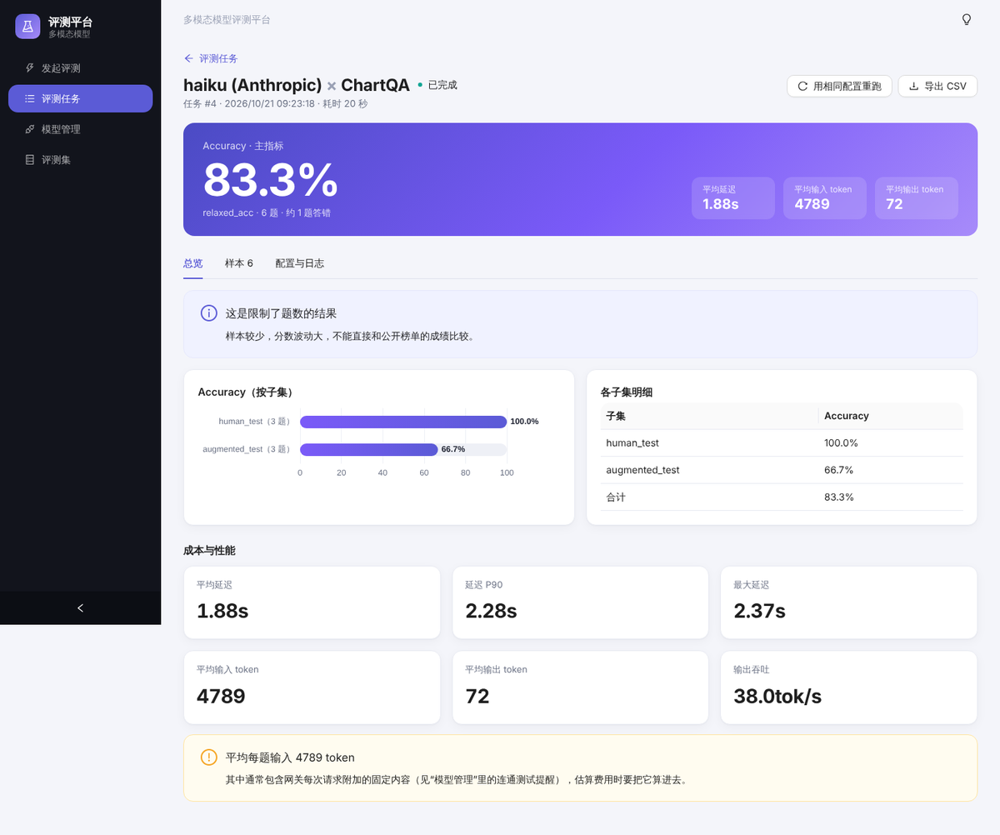
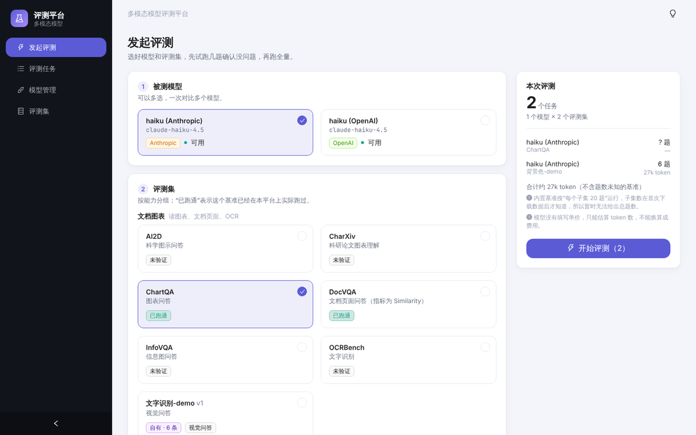
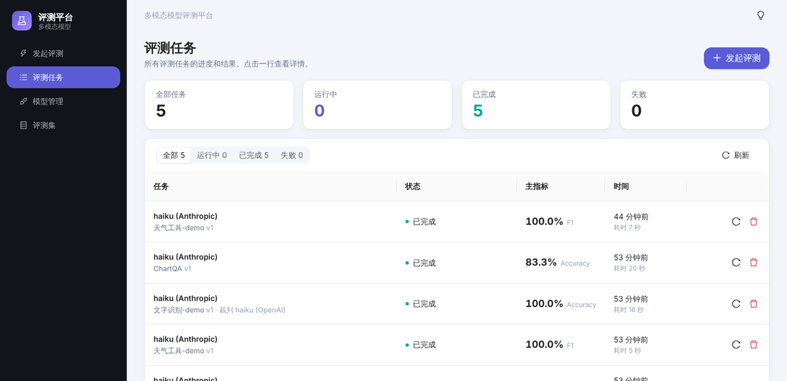
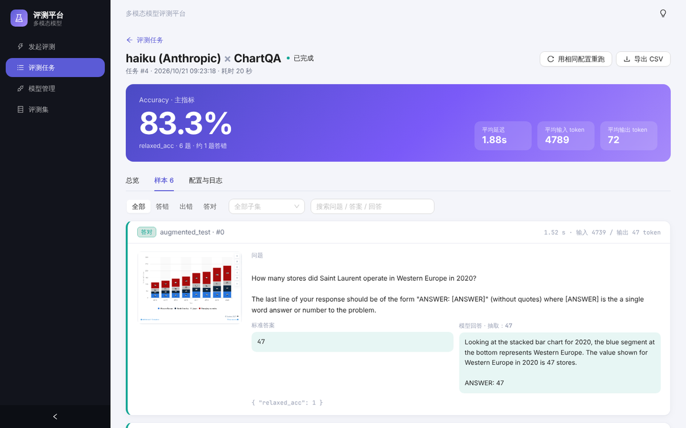
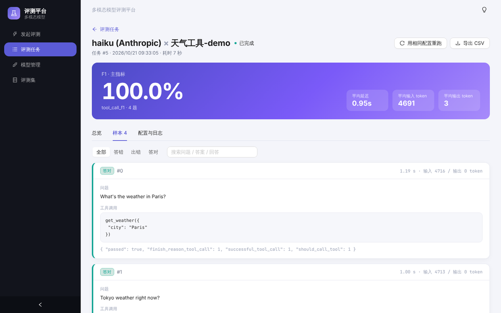
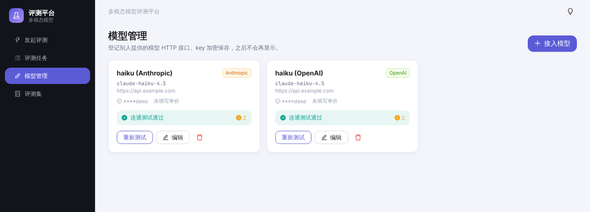
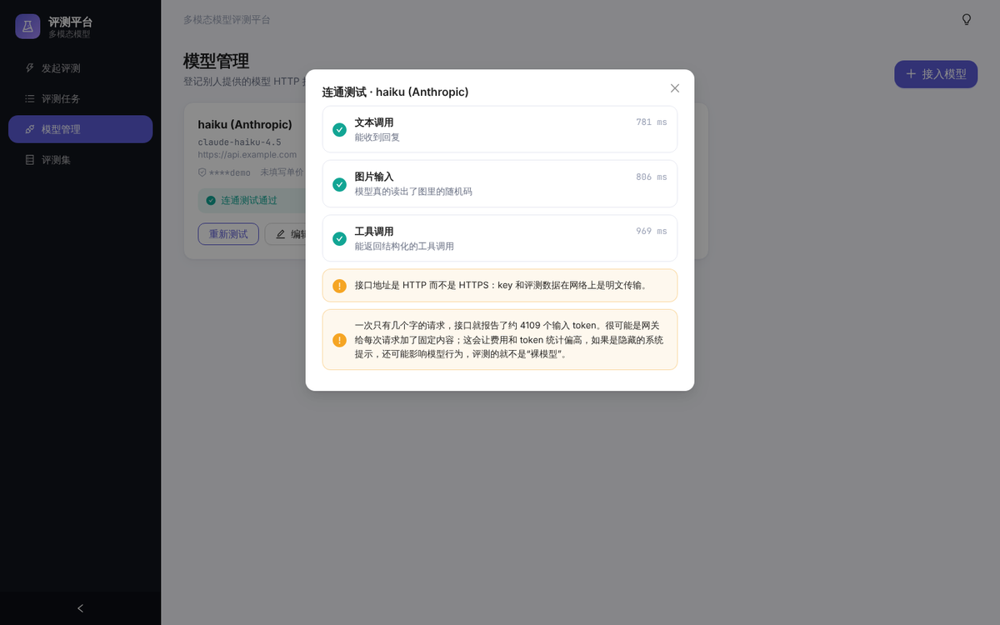
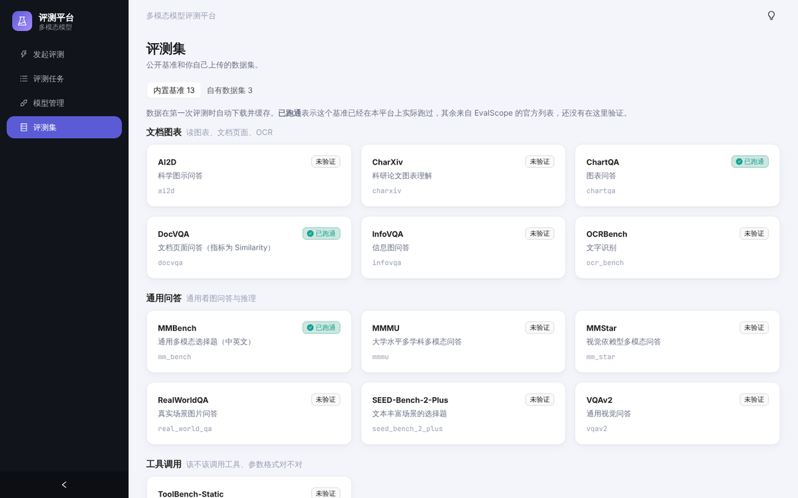
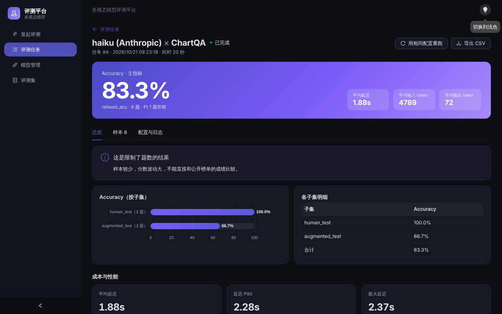

# 多模态模型评测平台

一个给团队内部用的**多模态大模型评测平台**：在网页上接入别人提供的模型 HTTP 接口（OpenAI / Anthropic 格式），选评测集，一键发起评测，然后在同一个页面看得分、延迟 / token 用量，以及逐条样本（图、问题、标准答案、模型回答、得分）。

评测引擎复用开源的 [EvalScope](https://github.com/modelscope/evalscope)；平台自己负责界面、任务管理、结果存储，以及对评测过程里几个容易“静默出错”的地方做检查（例如模型其实没看到图片，分数却照常产生）。



## 功能

- **接入模型**：登记别人给的接口（OpenAI 兼容或 Anthropic 兼容）。key 加密保存，页面和 API 都不再返回它。
- **连通测试**：不只是“能不能回话”——会画一张带随机码的图，检查模型是否**真的读出了图里的内容**，并检查能否返回结构化的工具调用；还会提醒接口是 HTTP 明文、以及每次请求的固定 token 开销过大。
- **评测集**：
  - 内置公开基准（按“文档图表 / 通用问答 / 工具调用”分组）；
  - 上传自有评测集（视觉问答、选择题、工具调用三种格式，`.jsonl` 或带图片的 `.zip`），上传时逐行校验，同名再传自动生成新版本。
- **发起评测**：一次选多个模型和多个评测集（每一对生成一个任务）；可配置裁判模型、题数（默认“试跑，每个子集 20 题”）、并发、最大输出、温度；提交前给出 token / 费用预估。
- **任务管理**：排队 / 运行 / 完成 / 失败 / 取消；显示阶段（下载基准数据、评测中……）和进度；支持取消、重试、用相同配置重跑、删除。
- **浅色 / 深色主题**：右上角一键切换，记住你的选择。
- **结果**：主指标和各子集得分、成本与性能（平均延迟、P90、平均输入 / 输出 token、吞吐）、逐条样本（可按答对 / 答错 / 出错、子集、关键词筛选，可放大图片）、导出 CSV、引擎日志。

| 发起评测：点选模型和评测集，右侧实时预估 | 评测任务：状态、进度、主指标一目了然 |
| --- | --- |
|  |  |

| 逐条样本：图、问题、标准答案和模型回答并排，答错的标红 | 工具调用样本 |
| --- | --- |
|  |  |

| 模型管理 | 连通测试 |
| --- | --- |
|  |  |

| 评测集 | 深色主题 |
| --- | --- |
|  |  |

## 架构

```
浏览器 ──REST──> API (FastAPI) ──写任务──> 数据库 <──取任务── Worker ──子进程──> EvalScope ──HTTP──> 被测模型接口
                                          (SQLite / PostgreSQL)    └─ 解析引擎输出，写入平台自己的 metric / sample 表
```

- **前端**：Vue 3 + TypeScript + [Ant Design Vue](https://antdv.com) 4 + ECharts，浅色 / 深色两套主题，构建后由后端直接托管。
- **后端**：FastAPI + SQLAlchemy。数据库默认 SQLite（单机够用），换 PostgreSQL 只需改 `DATABASE_URL`。
- **Worker**：独立进程，从数据库里取排队的任务，在子进程里调用评测引擎；取消时终止整个进程组；启动时把上次崩溃遗留的“运行中”任务重新排队。
- **引擎适配器**：平台只通过 `backend/app/engines/base.py` 里的 `EngineAdapter`（`prepare` / `progress` / `collect`）和引擎打交道。引擎的输出会被转成平台自己的表结构，所以**换引擎或升级引擎不需要改 API、表结构和前端**。
- **Anthropic 格式**：EvalScope 自带 `anthropic_api` 模式，所以不需要额外的格式转换网关。

## 快速开始

在 Python 3.13 和 Node 22 上开发和测试；其他版本没有验证过。

```bash
# 1. 后端依赖
cd backend
python -m venv .venv && source .venv/bin/activate
pip install -r requirements.txt

# 2. 构建前端（由后端托管）
cd ../frontend
npm install && npm run build

# 3. 启动：API 和 Worker 是两个进程，评测任务由 Worker 执行
cd ../backend
uvicorn app.main:app --port 8000      # 终端 1：打开 http://localhost:8000
python -m app.worker                  # 终端 2
```

接口文档（Swagger）在 <http://localhost:8000/docs>。

开发前端时用 `npm run dev`（<http://localhost:5173>，会把 `/api` 代理到 8000 端口）。

### 第一次使用

1. **模型管理 → 接入模型**：填名称、协议、接口地址（不用带 `/v1`）、模型名和 key。保存后会立刻做连通测试，**文本和图片两项都通过**才适合做多模态评测。
2. **评测集**：内置基准可以直接用；自有数据集在“自有数据集”页上传。
3. **发起评测**：选模型和评测集，先用默认的“试跑（每个子集 20 题）”确认一切正常，再跑全量。
4. **评测任务**：等任务完成，点进去看结果；先看“答错”的样本，再看总分。

## 自有评测集格式

三种格式沿用 EvalScope 的自定义格式。每行一条 JSON；媒体可以是相对路径（放在 zip 里）、`http(s)` 地址或 `data:` URL。

**视觉问答 `vqa`**（开放问答、OCR、图表问答）——`answer` 是标准答案，配上裁判模型才能算准确率，否则只有 BLEU / ROUGE：

```json
{"messages":[{"role":"user","content":[{"type":"text","text":"图里写了什么？"},{"type":"image_url","image_url":{"url":"img/1.png"}}]}],"answer":"ORBIT-208"}
```

**选择题 `vmcq`**——选项可以是文字或图片，`answer` 是正确选项的字母：

```json
{"question":"<image 1> 背景是什么颜色？","options":["黄色","蓝色","绿色"],"image_1":"img/1.png","answer":"B"}
```

**工具调用 `fc`**——`should_call_tool` 标明这条输入该不该调用工具：

```json
{"messages":[{"role":"user","content":"巴黎天气怎么样？"}],"tools":[{"type":"function","function":{"name":"get_weather","description":"查询天气","parameters":{"type":"object","properties":{"city":{"type":"string"}},"required":["city"]}}}],"should_call_tool":true}
```

带图片的数据集打成 zip：里面**恰好一个** `.jsonl`，图片按相对路径放在旁边。上传时会检查 JSON 是否合法、必填字段、选项范围、引用的媒体文件是否存在、压缩包有没有路径穿越。

## 怎么读结果

- **主指标**：每个基准自己的主指标，名字各不相同（Accuracy、Similarity、F1……），页面按基准各自的主指标展示，不假设都叫 accuracy。
- **工具调用只评“该不该调、工具名和参数格式对不对”**：样本格式里没有“期望的参数值”，所以不检查参数的值是否正确。
- **试跑的分数不能和公开榜单比**：试跑只取每个子集的前几题，样本太少，波动很大。
- **要看错题，不要只看总分**：评分规则有时比较严格。例如 ChartQA 里模型答“6.8%”、标准答案是“6.8”，会被判 0 分。
- **注意网关的固定开销**：有的网关会给每次请求附加固定内容（实测一个只有几个字的请求就报告了约 4100 个输入 token）。这会让 token 和费用偏高；如果是隐藏的系统提示，还可能影响模型行为。连通测试会对此给出提醒。

## 配置

通过环境变量配置：

| 环境变量 | 默认值 | 说明 |
| --- | --- | --- |
| `APP_DATA_DIR` | `backend/data` | 数据目录：数据库、加密密钥、上传的评测集、每次评测的输出（已在 `.gitignore` 里） |
| `DATABASE_URL` | `sqlite:///<数据目录>/app.db` | SQLAlchemy 连接串，换 PostgreSQL 时修改 |
| `APP_SECRET_KEY` | 自动生成到 `<数据目录>/secret.key`（权限 600） | 加密模型 API key 的 Fernet 密钥。**丢了它，已保存的 key 就解不开了** |
| `MAX_UPLOAD_MB` | `100` | 评测集上传大小上限 |
| `RUN_TIMEOUT_SEC` | `21600` | 单个评测任务的运行时间上限（超时会终止） |
| `WORKER_POLL_SEC` | `2` | Worker 轮询队列的间隔 |
| `FRONTEND_DIST` | `frontend/dist` | 前端构建产物目录 |

## API 概览

完整的接口和字段见 `/docs`。

| 方法与路径 | 说明 |
| --- | --- |
| `GET/POST /api/v1/models`、`PUT/DELETE /api/v1/models/{id}` | 模型接入（key 只写不读） |
| `POST /api/v1/models/{id}/check` | 连通测试（文本 / 看图 / 工具调用） |
| `GET/POST /api/v1/datasets`、`GET /datasets/{id}/preview`、`DELETE /datasets/{id}` | 评测集；`POST` 为 `multipart` 上传 |
| `POST /api/v1/runs/estimate` | 提交前的 token / 费用预估 |
| `POST /api/v1/runs` | 发起评测（模型 × 评测集 各一个任务；支持 `Idempotency-Key` 请求头防重复提交） |
| `GET /api/v1/runs`、`GET /runs/{id}` | 任务列表（可按状态筛选、分页）和详情 |
| `POST /runs/{id}/cancel`、`/retry`、`/rerun`、`DELETE /runs/{id}` | 取消、重试、用相同配置重跑、删除 |
| `GET /runs/{id}/metrics`、`/samples`、`/export`、`/log` | 指标、逐条样本（可筛选）、CSV、引擎日志 |

错误统一返回 `{"code": "...", "message": "..."}`（校验类错误另带 `details`）。

## 目录结构

```
backend/
  app/
    main.py            应用入口，注册路由、托管前端
    models.py          数据库表：模型、评测集、任务、指标、逐条样本
    routers/           models / datasets / runs 三组接口
    services/          连通测试、评测集校验、内置基准目录
    engines/           引擎适配器（接口、EvalScope 适配器、输出解析、子进程入口）
    worker.py          后台 Worker
  tests/               pytest；引擎用记录下来的真实 EvalScope 输出代替
frontend/
  src/views/           模型管理、评测集、发起评测、任务列表、结果页
  src/components/      页头、状态徽标、指标卡片、连通测试结果、图表等共用组件
  src/theme.ts         Ant Design 主题（主色、圆角、深色算法）；全局样式在 src/style.css
docs/images/           README 里的截图
```

## 开发与测试

```bash
cd backend && pytest             # 65 个测试，不需要网络和真实模型
cd frontend && npm run build     # 含 vue-tsc 类型检查
```

- 后端测试里的引擎是 `tests/fake_engine.py`：真实的配置生成、进度解析和结果解析代码，只是子进程改成把 `tests/fixtures/` 里记录的真实 EvalScope 1.14.0 输出拷贝到位，所以不需要调用任何模型。
- 想接入别的评测引擎：实现 `EngineAdapter` 的三个方法（`prepare`、`progress`、`collect`），在 `engines/__init__.py` 里注册即可。

## 安全

- 模型 key 用 Fernet 加密后存库；任何接口都不返回 key，页面只显示后四位。
- key 只通过环境变量传给评测子进程，**不写进配置文件、日志和结果目录**；错误信息和日志在展示前会把 key 替换掉。
- 上传的 zip 会检查路径穿越和解压后大小；样本图片接口只读取该任务自己的目录；CSV 导出会中和以 `=`、`+`、`-`、`@` 开头的单元格，防止公式注入。
- 评测会把评测集和提示发送给被测接口和裁判模型的服务商，上传含敏感数据的评测集前请先确认是否允许外发。
- **目前没有登录和权限**，见下面的限制。

## 已知限制与后续计划

- **没有登录和权限**：谁能访问就能看到所有模型和结果。部署前请放在内网，或者在前面加一层认证。（计划：简单账号，之后对接公司统一登录）
- **重试是从头开始**：目标是“已完成的样本不重复调用”，还没做。
- **只有一个 Worker，一次跑一个任务。**
- **费用上限没有拦截功能**：只有提交前的预估，默认不限制。
- **裁判模型只支持 OpenAI 格式的接口**；视频 / 音频输入、“图片 + 工具调用”的组合没有验证过。
- **内置基准里只有 `chartqa`、`docvqa`、`mm_bench` 在本平台实际跑通过**（页面上标“已跑通”），其余来自 EvalScope 的官方支持列表，没有在这里验证。
- 进度来自解析引擎日志里的进度条；非流式调用没有首字延迟（TTFT）。
- 还没做：综合得分、VLMEvalKit TSV 导入器、Docker 部署。
