# 多模态模型评测平台

一个给团队内部用的**多模态大模型评测平台**：在网页上接入别人提供的模型 HTTP 接口（OpenAI / Anthropic 格式），选评测集，一键发起评测，然后在同一个页面看得分、延迟 / token 用量，以及逐条样本（图、问题、标准答案、模型回答、得分）。

评测引擎复用开源的 [EvalScope](https://github.com/modelscope/evalscope)；平台自己负责界面、任务管理、结果存储，以及对评测过程里几个容易“静默出错”的地方做检查（例如模型其实没看到图片，分数却照常产生）。


## 功能

- **接入模型**：登记别人给的接口（OpenAI 兼容或 Anthropic 兼容）。key 加密保存，页面和 API 都不再返回它。
- **连通测试**：不只是“能不能回话”——会画一张带随机码的图，检查模型是否**真的读出了图里的内容**，并检查能否返回结构化的工具调用；还会提醒接口是 HTTP 明文、以及每次请求的固定 token 开销过大。
- **评测集**：
  - 内置公开基准（按“文档图表 / 通用问答 / 工具调用”分组）；
  - 上传自有评测集（视觉问答、选择题、工具调用三种格式，`.jsonl`、带图片的 `.zip`，或 VLMEvalKit 的 `.tsv` / `.csv`），上传时逐行校验，同名再传自动生成新版本。
- **发起评测**：一次选多个模型和多个评测集（每一对生成一个任务）；可配置裁判模型、题数（默认“试跑，每个子集 20 题”）、并发、最大输出、温度；提交前给出 token / 费用预估。
- **任务管理**：排队 / 运行 / 完成 / 失败 / 取消；显示阶段（下载基准数据、评测中……）和进度；支持取消、重试、用相同配置重跑、删除。
- **模型对比**：在任务列表勾选 2–8 个任务点“对比所选”（或一次选多个模型 × 一个评测集，提交后自动跳转）。并排显示得分、延迟、token、费用，每行最优高亮；按子集画图；“逐题对比”默认只列模型之间有分歧的题，可切到“全都答错”或“全部”。评测集版本、题数、温度、裁判模型等不一致时给出可比性提醒。
- **重试跳过已完成样本**：失败、取消或被费用上限停掉的任务重试时，已经答完的样本不会再调用模型，只补剩下的；任务详情显示跳过了多少题和累计用量。
- **费用限额（可选，默认不限制）**：在“费用限额”页设置单次评测和每月（UTC 自然月）的 token / 费用上限。提交时预估超限会弹窗确认；运行中实际用量超限会立刻停止任务，已完成的结果保留，调高上限后可重试续跑。
- **宽松匹配、参数检查与人工复核**：引擎的评分有时过于严格（比如标准答案 `6.8`、模型答 `6.8%` 会判错），工具调用题引擎也不看参数的值。平台在引擎得分之外再做一层：
  - **宽松匹配**：对引擎判错的答案再检查一遍，忽略大小写、空格、标点和全半角；数值忽略 `%`、千分位、货币符号和短单位后相等就算对。不做子串匹配，宁可漏判不误判。结果出来时自动执行；旧任务可以点“重新评分”（不重新调用模型）。用了裁判模型的任务不做宽松匹配，由裁判按语义判。
  - **工具调用参数检查**：自有评测集里写了 `expected_calls` 的题，会比对模型调用的工具名和参数值，引擎判对但参数不符的会被判错（见下面的格式）。
  - **人工复核**：每个样本可以手动“判对 / 判错”并写备注，再点一次取消；人工决定优先于一切。
  - **引擎得分永远保留**：页面同时给出“引擎得分”和“复核后得分”，样本上标明判定来源（宽松匹配 / 人工改判 / 人工确认），可筛选“有改判”；任务列表和模型对比也显示复核后得分，逐题对比按复核后的结果判断分歧。
  - 复核后得分只在引擎主指标是“逐题得分的平均”（Accuracy 这类）时才给；F1、BLEU 这类无法如实重算的，不给，也不会猜。
  - 重试后保留人工复核（回答没变的题）。
- **综合得分（权重在界面里配置）**：在“评分方案”页新建方案，选出哪几个评测集参与、每个占多大权重（可以存多套，比如“文档场景”“客服场景”），右边实时显示占比。在“模型对比”里选一个方案，就按权重把每个模型在各评测集上的得分合成一个综合得分并排名，点“怎么算的”能看到每一项的明细。规则很简单：加权平均；各评测集取主指标，有复核时用复核后的得分；某个模型缺方案里任何一个评测集的结果就不给综合得分（并说明缺哪个）；只支持百分比类的指标；包含试跑结果时会提示分数波动大。导出的对比报告也可以带上综合得分。
- **导出报告**：任务详情和模型对比页都有“导出报告”，生成一个单文件 HTML（没有外部依赖，图片已内嵌，可以直接发给别人、打印成 PDF）。单任务报告包含引擎得分和复核后得分、分子集得分、成本与性能、答错的题（带图、标准答案、模型回答、裁判意见和复核备注，最多 40 题）；对比报告包含逐项对比（每行最优高亮）和模型之间有分歧的题（最多 30 题）。报告里不含模型的地址和 key。
- **浅色 / 深色主题**：右上角一键切换，记住你的选择。
- **结果**：主指标和各子集得分、成本与性能（平均延迟、P90、平均输入 / 输出 token、吞吐）、逐条样本（可按答对 / 答错 / 出错、子集、关键词筛选，可放大图片）、导出 CSV、引擎日志。

| 发起评测：点选模型和评测集，右侧实时预估 | 评测任务：状态、进度、主指标一目了然 |
| --- | --- |
|  |  |

| 逐条样本：图、问题、标准答案和模型回答并排，答错的标红 | 工具调用样本 |
| --- | --- |
|  |  |

| 模型对比：得分、速度、费用并排，逐题看分歧 | 费用限额 |
| --- | --- |
| 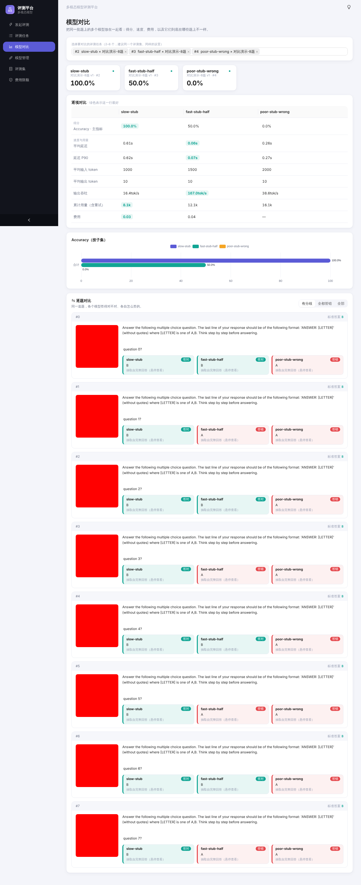 | 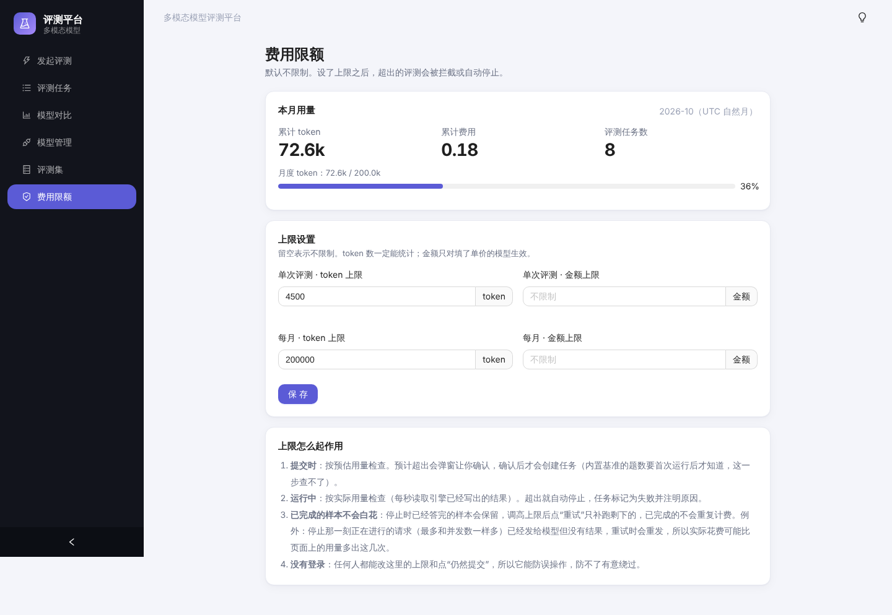 |

| 超出上限时提交需确认 | 运行中超限被停止，结果保留 |
| --- | --- |
| 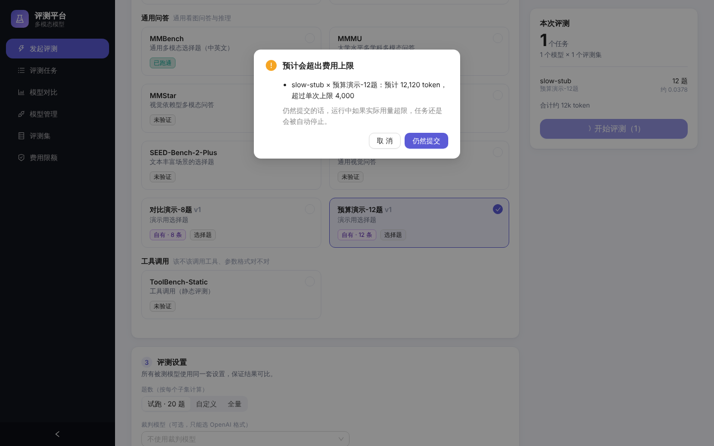 | 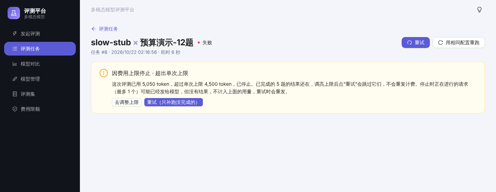 |

| 重试：跳过已答完的样本 | 勾选任务进行对比 |
| --- | --- |
| 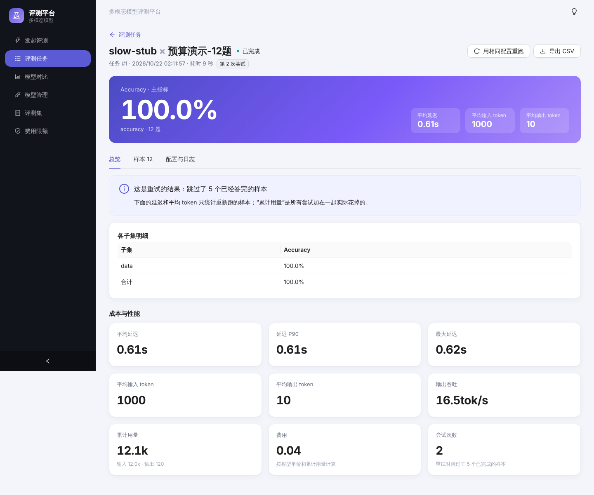 | 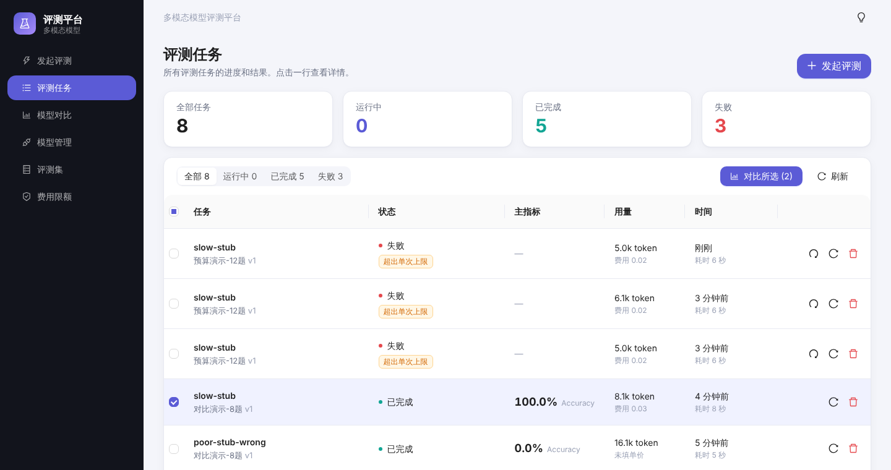 |

| 评分方案：权重在界面里配置，右边实时换算占比 | 对比页的综合得分和排名 |
| --- | --- |
| 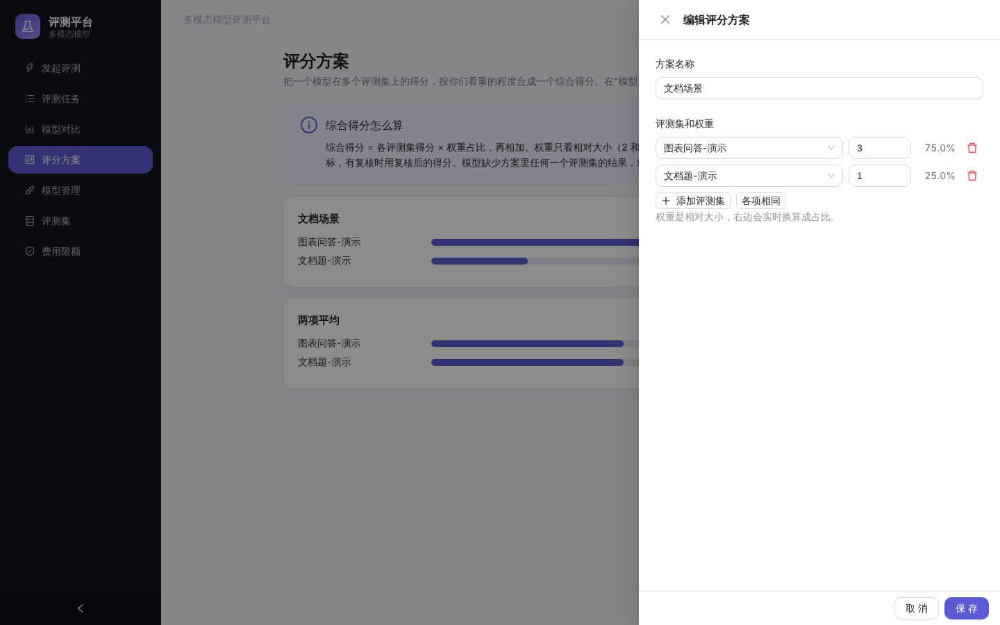 | 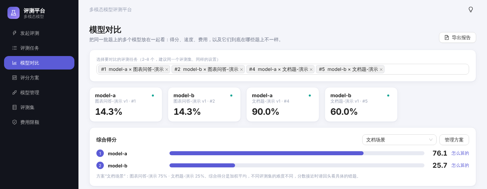 |

| 导出的单任务报告 | 导出的对比报告 |
| --- | --- |
| 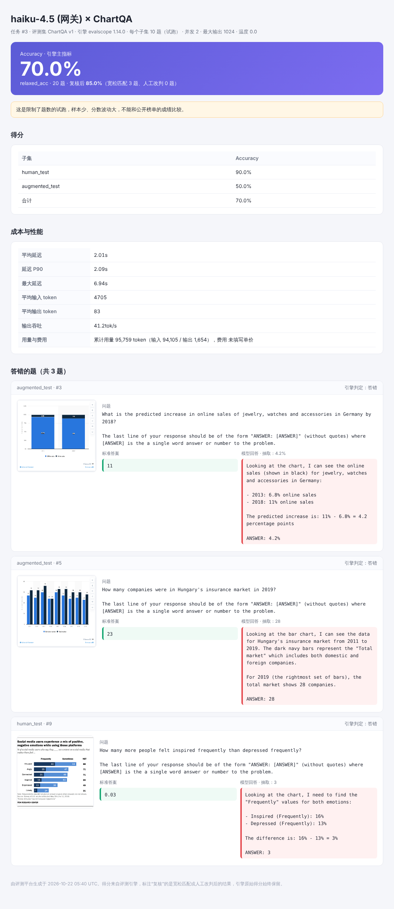 | 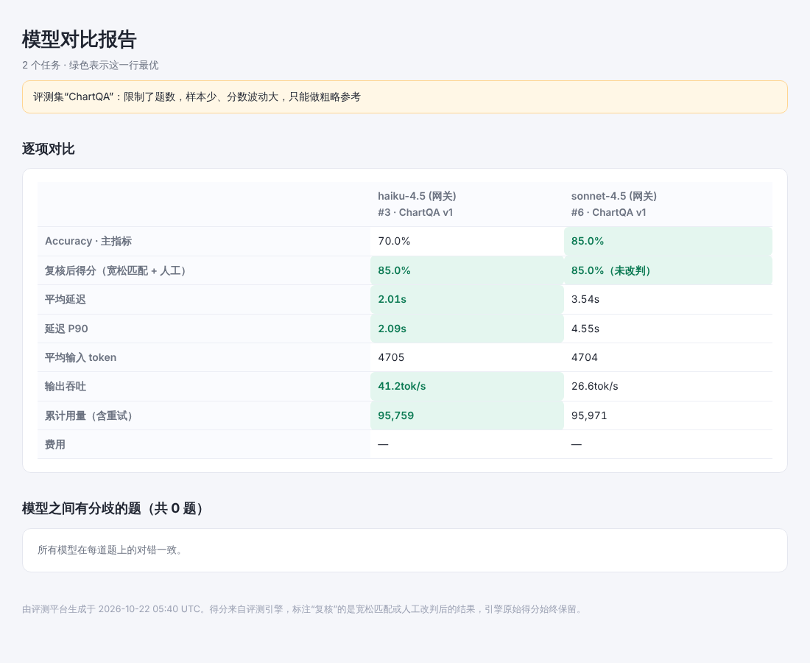 |

| 样本：宽松匹配通过的带标记，每题可人工判对 / 判错 | 任务列表显示复核后得分 |
| --- | --- |
| 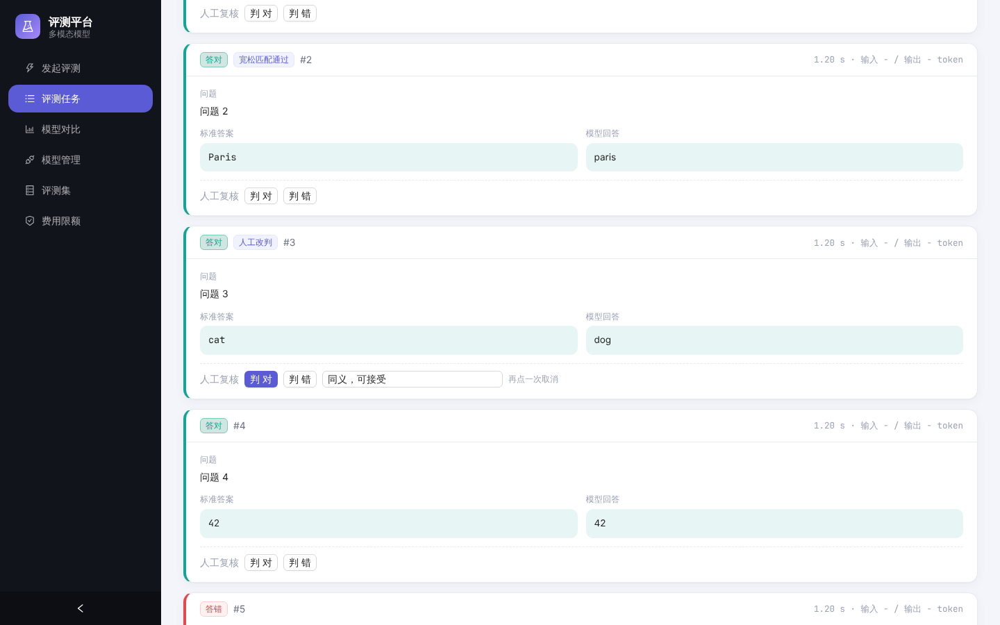 | 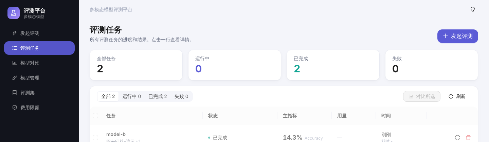 |

| 任务页顶部显示在线的 Worker | |
| --- | --- |
| 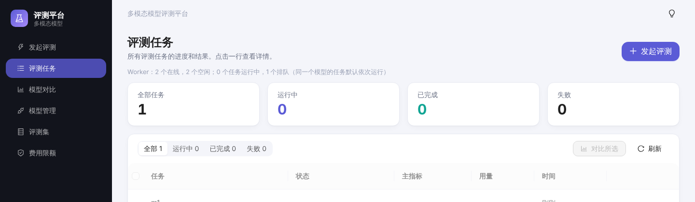 | |

| 模型管理 | 连通测试 |
| --- | --- |
|  |  |

| 评测集 | 深色主题 |
| --- | --- |
|  |  |

## 架构

```
浏览器 ──REST──> API (FastAPI) ──写任务──> 数据库 <──取任务── Worker ──子进程──> EvalScope ──HTTP──> 被测模型接口
                                          (SQLite / PostgreSQL)    └─ 解析引擎输出，写入平台自己的 metric / sample 表
```

- **前端**：Vue 3 + TypeScript + [Ant Design Vue](https://antdv.com) 4 + ECharts，浅色 / 深色两套主题，构建后由后端直接托管。
- **后端**：FastAPI + SQLAlchemy。数据库默认 SQLite（单机够用），换 PostgreSQL 只需改 `DATABASE_URL`。
- **Worker**：独立进程，从数据库里取排队的任务，在子进程里调用评测引擎；取消时终止整个进程组；启动时把上次崩溃遗留的“运行中”任务重新排队。
- **引擎适配器**：平台只通过 `backend/app/engines/base.py` 里的 `EngineAdapter`（`prepare` / `progress` / `collect`）和引擎打交道。引擎的输出会被转成平台自己的表结构，所以**换引擎或升级引擎不需要改 API、表结构和前端**。
- **Anthropic 格式**：EvalScope 自带 `anthropic_api` 模式，所以不需要额外的格式转换网关。

## 快速开始

在 Python 3.13 和 Node 22 上开发和测试；其他版本没有验证过。

```bash
# 1. 后端依赖
cd backend
python -m venv .venv && source .venv/bin/activate
pip install -r requirements.txt

# 2. 构建前端（由后端托管）
cd ../frontend
npm install && npm run build

# 3. 启动：API 和 Worker 是两个进程，评测任务由 Worker 执行
cd ../backend
uvicorn app.main:app --port 8000      # 终端 1：打开 http://localhost:8000
python -m app.worker                  # 终端 2
```

接口文档（Swagger）在 <http://localhost:8000/docs>。

开发前端时用 `npm run dev`（<http://localhost:5173>，会把 `/api` 代理到 8000 端口）。

### 第一次使用

1. **模型管理 → 接入模型**：填名称、协议、接口地址（不用带 `/v1`）、模型名和 key。保存后会立刻做连通测试，**文本和图片两项都通过**才适合做多模态评测。
2. **评测集**：内置基准可以直接用；自有数据集在“自有数据集”页上传。
3. **发起评测**：选模型和评测集，先用默认的“试跑（每个子集 20 题）”确认一切正常，再跑全量。
4. **评测任务**：等任务完成，点进去看结果；先看“答错”的样本，再看总分。

## 自有评测集格式

三种格式沿用 EvalScope 的自定义格式。每行一条 JSON；媒体可以是相对路径（放在 zip 里）、`http(s)` 地址或 `data:` URL。

**视觉问答 `vqa`**（开放问答、OCR、图表问答）——`answer` 是标准答案，配上裁判模型才能算准确率，否则只有 BLEU / ROUGE：

```json
{"messages":[{"role":"user","content":[{"type":"text","text":"图里写了什么？"},{"type":"image_url","image_url":{"url":"img/1.png"}}]}],"answer":"ORBIT-208"}
```

**选择题 `vmcq`**——选项可以是文字或图片，`answer` 是正确选项的字母：

```json
{"question":"<image 1> 背景是什么颜色？","options":["黄色","蓝色","绿色"],"image_1":"img/1.png","answer":"B"}
```

**工具调用 `fc`**——`should_call_tool` 标明这条输入该不该调用工具：

```json
{"messages":[{"role":"user","content":"巴黎天气怎么样？"}],"tools":[{"type":"function","function":{"name":"get_weather","description":"查询天气","parameters":{"type":"object","properties":{"city":{"type":"string"}},"required":["city"]}}}],"should_call_tool":true}
```

要连**参数的值**一起检查，在该行加 `expected_calls`（可选；不写就只评“该不该调、格式对不对”）：

```json
{"messages":[...],"tools":[...],"should_call_tool":true,
 "expected_calls":[{"name":"get_weather","arguments":{"city":"Paris"}}]}
```

引擎只判断“该不该调、调用格式是否合法”，参数值由平台再比对一遍（不调用任何模型）：每个期望的调用都要有一个同名的实际调用；`arguments` 里写出的参数都必须存在且值相等，模型多加的参数忽略；字符串忽略大小写和首尾空格，数字按数值比（`5`、`"5"`、`5.0` 相同），列表和对象逐项比；值也可以写 `{"$any": true}`（必须有，任意值）或 `{"$regex": "^Par"}`（文本匹配正则）；有多个期望调用时顺序不限；模型多调用了没期望的工具算错，除非该行写 `"allow_extra_calls": true`。引擎判对但参数不符的样本会被标为“参数检查未通过”，复核后得分相应降低，原因写在样本上；`expected_calls` 会作为“标准答案”显示。只有写了 `expected_calls` 的行才做这个检查。

**自有工具调用评测集的主指标是平台算的“通过率”**（逐题通过的比例，含参数检查和人工复核）。引擎自己的主指标是 F1，只衡量“该不该调用工具”的判断，哪怕调用格式不合法、参数写错了也可能是 100%，也没法在参数检查或人工复核之后重算，所以平台另算了通过率作为主指标；引擎的 F1、格式准确率仍作为其他指标保留。内置的 ToolBench-Static 不受影响。

带图片的数据集打成 zip：里面**恰好一个** `.jsonl`，图片按相对路径放在旁边。上传时会检查 JSON 是否合法、必填字段、选项范围、引用的媒体文件是否存在、压缩包有没有路径穿越。

**VLMEvalKit 的 TSV / CSV**：直接上传 `.tsv` 或 `.csv`（需要 `question`、`answer` 两列）。有 `A`、`B`、`C`… 选项列的按选择题导入（类型选 `vmcq`），没有的按开放问答导入（类型选 `vqa`）。`image` 列可以是 base64、base64 列表，或 MMBench 那样指向另一行 `index` 的引用；`hint` 会拼到问题前面；`category` 等列保留。类型选错时会提示该选哪个。

## 怎么读结果

- **主指标**：每个基准自己的主指标，名字各不相同（Accuracy、Similarity、F1……），页面按基准各自的主指标展示，不假设都叫 accuracy。
- **工具调用默认只评“该不该调、工具名和参数格式对不对”**：要检查参数的值，要在自有评测集里写 `expected_calls`（见上面的格式）；内置的工具调用基准没有这个信息，不检查参数值。
- **试跑的分数不能和公开榜单比**：试跑只取每个子集的前几题，样本太少，波动很大。
- **要看错题，不要只看总分**：评分规则有时比较严格。例如 ChartQA 里模型答“6.8%”、标准答案是“6.8”，引擎会判 0 分；平台的宽松匹配会把这类标出来，但引擎得分本身不改。
- **注意网关的固定开销**：有的网关会给每次请求附加固定内容（实测一个只有几个字的请求就报告了约 4100 个输入 token）。这会让 token 和费用偏高；如果是隐藏的系统提示，还可能影响模型行为。连通测试会对此给出提醒。

## 多个 Worker 并行

评测任务由 Worker 执行，可以同时开多个，互不干扰：

```bash
WORKER_CONCURRENCY=3 python -m app.worker      # 一个进程同时跑 3 个任务
python -m app.worker                           # 或者多开几个进程，甚至放在多台机器上（共用数据库和数据目录）
docker compose up -d --scale worker=3          # Docker：3 个 Worker 进程
```

- **同一个模型默认一次只跑一个任务**，免得把服务商的限流打满（每个任务自己还会按“并发”并行发请求）。能承受更多的话，在“模型管理”里调大这个模型的“同时评测的任务数”。不同模型的任务可以同时跑，所以“多个模型 × 一个评测集”的对比能真正并行。
- 每个 Worker 定时上报心跳。**Worker 挂了**（崩溃、断电、被 `kill -9`），其他 Worker 在 `WORKER_STALE_SEC`（默认 45 秒）后接手它的任务，已经答完的样本不会重新计费；如果被遗弃的评测进程还在同一台机器上，会被杀掉。这 45 秒内，那个进程可能还在继续调用模型，所以在这段时间里会多花一点点用量。
- **服务商临时出错会自动续跑**：任务因为服务商返回 429、5xx、超时、连接被重置而失败时（引擎自己已经重试过一轮），平台会把任务放回队列，按 1 分钟、2 分钟……退避后接着跑（只补没答的题），最多自动重试 `AUTO_RETRY_MAX`（默认 2）次，用完才算失败；认证错误、请求格式错误这类不会自己好的问题直接失败。任务详情会显示“已排队自动重试”和下次尝试时间。手动点“重试”会重新给足次数。
- **服务商卡住（不报错也不返回）**：评测阶段超过 `STALL_TIMEOUT_SEC`（默认 20 分钟）没有任何新的回答，就终止并按上面的规则自动重试，不用等 6 小时的总时限。下载数据阶段不受这个限制（首次下载大数据集本来就慢）。
- **正常停止 Worker**（`SIGTERM` / `Ctrl+C`，`docker stop`）：它不再领新任务，停掉手上的评测，把任务放回队列，下一个 Worker 接着跑。
- 任务页顶部显示在线的 Worker 数；有任务排队但没有 Worker 在线时会提示。
- 领任务靠数据库里的一条原子更新，不会被两个 Worker 同时领走；“同一个模型的并行上限”在 SQLite 下是严格的，换成 PostgreSQL 时在极端并发下可能短暂多放过一个（PostgreSQL 本来也没测过）。

## Docker 部署

```bash
docker compose up -d --build     # 打开 http://localhost:8000
```

`api` 和 `worker` 两个服务共用一个数据卷（数据库、加密密钥、评测集、结果）；`docker compose up -d --scale worker=3` 可以开多个 Worker。数据卷里的 `secret.key` 要和 `app.db` 一起备份。注意：这份 Docker 配置写好了，但我没能在开发环境里构建验证（环境里没有 Docker 服务），第一次用请留意。

仓库带了 GitHub Actions（`.github/workflows/ci.yml`）：后端测试，前端类型检查加构建。

## 配置

通过环境变量配置：

| 环境变量 | 默认值 | 说明 |
| --- | --- | --- |
| `APP_DATA_DIR` | `backend/data` | 数据目录：数据库、加密密钥、上传的评测集、每次评测的输出（已在 `.gitignore` 里） |
| `DATABASE_URL` | `sqlite:///<数据目录>/app.db` | SQLAlchemy 连接串，换 PostgreSQL 时修改 |
| `APP_SECRET_KEY` | 自动生成到 `<数据目录>/secret.key`（权限 600） | 加密模型 API key 的 Fernet 密钥。**丢了它，已保存的 key 就解不开了** |
| `MAX_UPLOAD_MB` | `100` | 评测集上传大小上限 |
| `RUN_TIMEOUT_SEC` | `21600` | 单个评测任务的运行时间上限（超时会终止） |
| `WORKER_POLL_SEC` | `2` | Worker 轮询队列的间隔 |
| `WORKER_CONCURRENCY` | `1` | 一个 Worker 进程同时跑几个评测任务 |
| `AUTO_RETRY_MAX` | `2` | 服务商临时错误后自动重试的最多次数，`0` 关闭 |
| `AUTO_RETRY_BASE_SEC` | `60` | 自动重试的退避起点（秒），之后每次翻倍 |
| `STALL_TIMEOUT_SEC` | `1200` | 评测中这么久没有新回答就认为服务商卡住了，终止并自动重试；`0` 关闭 |
| `WORKER_STALE_SEC` | `45` | 多久没有心跳就认为 Worker 已经挂了，由其他 Worker 接手它的任务 |
| `FRONTEND_DIST` | `frontend/dist` | 前端构建产物目录 |

## API 概览

完整的接口和字段见 `/docs`。

| 方法与路径 | 说明 |
| --- | --- |
| `GET/POST /api/v1/models`、`PUT/DELETE /api/v1/models/{id}` | 模型接入（key 只写不读） |
| `POST /api/v1/models/{id}/check` | 连通测试（文本 / 看图 / 工具调用） |
| `GET/POST /api/v1/datasets`、`GET /datasets/{id}/preview`、`DELETE /datasets/{id}` | 评测集；`POST` 为 `multipart` 上传 |
| `POST /api/v1/runs/estimate` | 提交前的 token / 费用预估 |
| `POST /api/v1/runs` | 发起评测（模型 × 评测集 各一个任务；支持 `Idempotency-Key` 请求头防重复提交） |
| `GET /api/v1/runs`、`GET /runs/{id}` | 任务列表（可按状态筛选、分页）和详情 |
| `GET /api/v1/workers` | 在线的 Worker 槽位、空闲数、排队和运行中的任务数 |
| `POST /runs/{id}/cancel`、`/retry`、`/rerun`、`DELETE /runs/{id}` | 取消、重试、用相同配置重跑、删除 |
| `GET /api/v1/compare?run_ids=1,2,3`、`GET /compare/samples` | 多任务对比：指标与可比性提醒；逐题对齐（`view=diff|all_wrong|all`） |
| `GET/PUT /api/v1/settings/budget` | 费用限额与本月已用；`POST /runs` 预估超限返回 409 `budget_exceeded`，带 `confirm_over_budget: true` 再提交 |
| `PUT /runs/{id}/samples/{sample_id}/review`、`POST /runs/{id}/rescore`、`GET /runs/{id}/adjusted` | 人工改判（`correct: null` 取消）；宽松匹配重新评分；复核后得分（含各子集） |
| `GET/POST /api/v1/schemes`、`PUT/DELETE /schemes/{id}`、`GET /compare/composite?run_ids=&scheme_id=` | 评分方案（评测集 + 权重）和综合得分 |
| `GET /api/v1/runs/{id}/report`、`GET /api/v1/compare/report?run_ids=` | 单文件 HTML 报告（加 `download=true` 触发下载） |
| `GET /runs/{id}/metrics`、`/samples`、`/export`、`/log` | 指标、逐条样本（可筛选）、CSV、引擎日志 |

错误统一返回 `{"code": "...", "message": "..."}`（校验类错误另带 `details`）。

## 目录结构

```
backend/
  app/
    main.py            应用入口，注册路由、托管前端
    models.py          数据库表：模型、评测集、任务、指标、逐条样本
    routers/           models / datasets / runs 三组接口
    services/          连通测试、评测集校验、内置基准目录
    engines/           引擎适配器（接口、EvalScope 适配器、输出解析、子进程入口）
    worker.py          后台 Worker
  tests/               pytest；引擎用记录下来的真实 EvalScope 输出代替
frontend/
  src/views/           模型管理、评测集、发起评测、任务列表、结果页
  src/components/      页头、状态徽标、指标卡片、连通测试结果、图表等共用组件
  src/theme.ts         Ant Design 主题（主色、圆角、深色算法）；全局样式在 src/style.css
docs/images/           README 里的截图
```

## 开发与测试

```bash
cd backend && pytest             # 后端测试，不需要网络和真实模型
cd frontend && npm run build     # 含 vue-tsc 类型检查
pip install -r e2e/requirements.txt && playwright install chromium
python -m pytest e2e             # 浏览器测试：真实的页面 + 接口，用灌好的数据，不调用模型（需要先 npm run build）
```

浏览器测试在 `e2e/`，用 Playwright 打开构建好的应用，覆盖任务列表、复核后得分、人工复核、对比页和报告、模型表单、费用上限确认、深色主题；任何页面出现未捕获的异常或控制台报错都会让测试失败。沙箱里没有自带浏览器时用 `CHROMIUM_PATH` 指定 Chromium 的位置。CI（`.github/workflows/ci.yml`）里三项都会跑。

- 后端测试里的引擎是 `tests/fake_engine.py`：真实的配置生成、进度解析和结果解析代码，只是子进程改成把 `tests/fixtures/` 里记录的真实 EvalScope 1.14.0 输出拷贝到位，所以不需要调用任何模型。
- 想接入别的评测引擎：实现 `EngineAdapter` 的三个方法（`prepare`、`progress`、`collect`），在 `engines/__init__.py` 里注册即可。

## 安全

- 模型 key 用 Fernet 加密后存库；任何接口都不返回 key，页面只显示后四位。
- key 只通过环境变量传给评测子进程，**不写进配置文件、日志和结果目录**；错误信息和日志在展示前会把 key 替换掉。
- 上传的 zip 会检查路径穿越和解压后大小；样本图片接口只读取该任务自己的目录；CSV 导出会中和以 `=`、`+`、`-`、`@` 开头的单元格，防止公式注入。
- 评测会把评测集和提示发送给被测接口和裁判模型的服务商，上传含敏感数据的评测集前请先确认是否允许外发。
- **目前没有登录和权限**，见下面的限制。

## 已知限制与后续计划

- **没有登录和权限**：谁能访问就能看到所有模型和结果。部署前请放在内网，或者在前面加一层认证。（计划：简单账号，之后对接公司统一登录）
- **续跑的两个细节**：停止瞬间正在进行的请求（最多等于并发数）服务商可能已计费，但结果没落盘，重试时会重发，所以记录的用量可能比实际少这几个请求；续跑任务的延迟、吞吐只统计新跑的样本。
- **费用限额只是防手滑，不是安全边界**：没有登录，确认弹窗谁都能点；费用只对填了单价的模型计算。
- **裁判模型只支持 OpenAI 格式的接口**；视频 / 音频输入、“图片 + 工具调用”的组合没有验证过。
- **在真实网关上验证过的范围**：用一个真实网关（同时提供 Anthropic 和 OpenAI 两种协议入口；Anthropic 协议跑了 haiku-4.5 和 sonnet-4.5，OpenAI 协议跑了 haiku-4.5）跑通了：连通测试（文本 / 看图 / 工具调用）、自有的看图选择题（zip 带图）、工具调用评测集、内置 ChartQA（每个子集 10 题）、两个模型并行、超限停止后重试续跑（已答完的题不重复计费）、宽松匹配（ChartQA 里 `6.8%` 对 `6.8` 这类被正确挑出）。两种协议的结果一致（同一个模型在两条路径上的差别只来自温度 0 下的正常波动）。之后又验证了：裁判模型（sonnet-4.5 给开放问答打分，输出可读）、内置的 AI2D / OCRBench / MMStar / SEED-Bench-2-Plus / RealWorldQA / ToolBench-Static / CharXiv（每个只跑几题，标为“已跑通”）、服务商持续返回 503 / 429 时的自动续跑（用本地模拟服务）。**没验证过**：InfoVQA、VQAv2、MMMU（网关当时不可用 / 数据集下载很慢）；工具调用的参数检查只在本地模拟模型上验证过，没在真实网关上跑；其他服务商的 OpenAI 兼容接口（各家对图片、工具调用的实现有差异）；视频 / 音频；全量跑公开基准。
- **网关的固定开销很大**：实测每次请求带约 4.4k 输入 token（与题目长短无关），小评测集的 token 大部分花在这上面；估算费用时要把它算进去。
- **内置基准里只有 `chartqa`、`docvqa`、`mm_bench` 在本平台实际跑通过**（页面上标“已跑通”），其余来自 EvalScope 的官方支持列表，没有在这里验证。
- 进度来自解析引擎日志里的进度条；非流式调用没有首字延迟（TTFT）。

